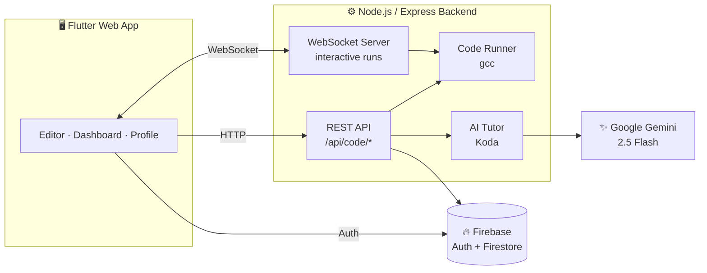

<div align="center">

# 🧠 KodLearn

### Learn C programming by writing real code, with an AI tutor that guides you instead of giving you the answer.

<p>
  
  
  
  
  
  
</p>

<p>
  <a href="#-features">Features</a> •
  <a href="#-curriculum">Curriculum</a> •
  <a href="#-architecture">Architecture</a> •
  <a href="#-getting-started">Getting Started</a> •
  <a href="#-api-reference">API</a> •
  <a href="#-project-structure">Structure</a>
</p>

</div>

---

## ✨ Overview

**KodLearn** is an interactive, gamified platform for learning the **C programming language**, built for Turkish-speaking students. You write code in a browser editor and it is compiled and run on a real `gcc` toolchain. **Koda**, an AI tutor powered by Google Gemini, then reviews your work.

Koda never just gives you the solution. Like a good teacher, it asks guiding questions, points to the line where things went wrong and keeps you motivated, so you actually learn to *think* in C.

> 🇹🇷 The app interface and the AI tutor speak **Turkish**.

---

## 🚀 Features

### 💻 In-browser code editor
- **Syntax highlighting** for C, built with a custom token-coloring text controller
- **Live interactive terminal** over WebSockets: programs that call `scanf` work in real time, and you type input as the program asks for it
- Output buffering is turned off automatically, so prompts like `printf("Sayı giriniz: ")` show up right away
- Compiler error line numbers match exactly what you see in the editor
- 10-second execution timeout guards against infinite loops

### 🤖 Koda, the AI tutor
- **Automatic feedback** after every run, based on your code, the compiler and runtime output, and the concepts the problem teaches
- **Smart hints** with structured JSON output: Koda pinpoints the **exact line** of the bug and gives a short nudge in the right direction
- **Chat** with Koda about the current problem at any time, with conversation history kept
- Socratic by design: it is prompted to *never* give the direct answer

### ✅ Fair, human-like grading
The grader doesn't punish cosmetic differences the way a strict character-by-character diff would:

| Check | Score |
|---|:---:|
| Exact match | **100** |
| Same output once whitespace is normalized | **100** |
| Case-insensitive match (Turkish-locale aware) | **98** |
| Expected answer found inside the output, e.g. `Sonuç: 12` for `12` | **95** |
| Character-similarity fallback (capped so near-misses can't pass) | **≤ 80** |

A negation guard makes sure `Asal Değil` is **never** accepted for `Asal`. A problem counts as solved at **90% or higher**.

### 🎮 Gamification and progress
- 🔓 **Progressive unlocking**: in each chapter, *Kolay* (easy) → *Orta* (medium) → *Zor* (hard)
- 🔥 **Daily streaks** with a weekly activity row (Mon → Sun)
- 📊 **GitHub-style activity heatmap** for the last 52 weeks on your profile
- 🏆 **Leaderboard** ranked by total score (+10 points per solved problem)
- 🎉 **Confetti** when you solve a problem
- 📈 **Level badge**: Beginner → Intermediate → Advanced

### 🎨 Polished UX
- ⌨️ **Command palette** opened with `Cmd/Ctrl + K` from anywhere
- 👋 **Onboarding tour** for first-time users
- ✉️ **Email verification** flow with automatic detection
- 🌊 Apple-style staggered fade-in animations, smooth page transitions and animated video backgrounds
- 📚 **Theory pages** for every topic at `/context/:topicId`

---

## 📚 Curriculum

**6 chapters · 30 hands-on problems**, each chapter split into easy, medium and hard tiers.

| # | Chapter | Topics | Sample problems |
|:-:|---|---|---|
| 1 | **C Diline Giriş** (Introduction to C) | I/O, variables, types, operators | Hello World, Circle Area, Celsius → Fahrenheit |
| 2 | **Akış Kontrolü** (Flow Control) | `if/else`, loops, `switch` | Odd or Even, Multiplication Table, **FizzBuzz** |
| 3 | **Fonksiyonlar** (Functions) | Parameters, `return` | Factorial, Prime Check, Power |
| 4 | **Diziler** (Arrays) | Arrays, strings, sorting | Linear Search, Bubble Sort, String Reverse |
| 5 | **İşaretçiler** (Pointers) | Pointer arithmetic, pass-by-reference | Pointer Swap, `strlen` without `strlen` |
| 6 | **Yapı ve Dosya** (Structs and Files) | `struct`, `fopen`/`fprintf`/`fscanf` | Student Record, Point Distance, File I/O |

---

## 🏗 Architecture



| Layer | Technology |
|---|---|
| **Frontend** | Flutter (Web), Dart, `go_router`, `web_socket_channel`, `video_player` |
| **Backend** | Node.js, Express 5, `ws`, `child_process` + `gcc` |
| **AI** | Google Gemini 2.5 Flash (`@google/generative-ai`) with structured output |
| **Auth and database** | Firebase Authentication, Cloud Firestore, Firebase Admin SDK |

---

## 🛠 Getting Started

### Prerequisites

- [Flutter SDK](https://docs.flutter.dev/get-started/install) (Dart ≥ 3.11)
- [Node.js](https://nodejs.org/) 18+
- **gcc** (on macOS: `xcode-select --install`)
- A [Firebase](https://console.firebase.google.com/) project with **Email/Password Auth** and **Firestore** enabled
- A [Google Gemini API key](https://aistudio.google.com/app/apikey)

### 1️⃣ Clone the repository

```bash
git clone https://github.com/ysfthaay/KodLearn.git
cd KodLearn
```

### 2️⃣ Set up the backend

```bash
cd backend
npm install
```

Create a `backend/.env` file:

```env
Gemini_API_Key=your_gemini_api_key_here
PORT=3000
```

Add your Firebase service account key:

1. Open Firebase Console → ⚙️ **Project Settings** → **Service accounts**
2. Click **Generate new private key**
3. Save the file as **`backend/firebase-key.json`**

> ⚠️ `.env` and `firebase-key.json` contain secrets and are git-ignored. **Never commit them.**

Start the server:

```bash
npm start
```

You should see:

```
🤖 AI provider: Gemini  |  key loaded: yes
Server 3000 portunda çalışıyor...
```

### 3️⃣ Set up the frontend

```bash
cd ../frontend
flutter pub get
flutter run -d chrome
```

> 💡 To use your own Firebase project, regenerate `lib/firebase_options.dart` with `flutterfire configure`.

---

## 📡 API Reference

Base URL: `http://localhost:3000/api/code`

| Method | Endpoint | Description |
|:---:|---|---|
| `POST` | `/run` | Compile and run code, grade it against the problem and return AI feedback. Body: `{ code, problemId, uid, stdin }` |
| `POST` | `/hint` | Get a structured hint: `{ success, errorLine, hint }` |
| `POST` | `/chat` | Chat with Koda. Body: `{ message, problemId, chatHistory }` |
| `GET` | `/level/:uid` | The user's level, unlocked problems and completed problems |
| `POST` | `/streak` | Update and return the daily streak and weekly active days |
| `GET` | `/leaderboard?limit=10` | Top users by score (max 50) |

**WebSocket** at `ws://localhost:3000` for interactive runs:

```jsonc
// Client → Server
{ "type": "run",   "code": "..." }
{ "type": "input", "data": "42" }
{ "type": "kill" }

// Server → Client
{ "type": "started" }
{ "type": "output", "data": "..." }
{ "type": "error",  "data": "..." }
{ "type": "done",   "exitCode": 0 }
```

---

## 📁 Project Structure

```
KodLearn/
├── backend/
│   └── src/
│       ├── server.js            # Express + WebSocket server (interactive runs)
│       ├── config/firebase.js   # Firebase Admin initialization
│       ├── routes/code.js       # REST endpoints, grading, unlocks, streaks
│       └── services/
│           ├── aiTutor.js       # Koda: Gemini feedback, chat and hints
│           └── codeRunner.js    # gcc compile and run with timeout
│
└── frontend/
    ├── assets/                  # Animated background videos
    └── lib/
        ├── main.dart            # App entry and routes
        ├── data/                # Course content and problem set
        ├── pages/               # Login, Dashboard, Editor, Profile, Context
        └── widgets/             # Heatmap, Command Palette, Confetti, Onboarding…
```

---

## 🗺 Roadmap

- [ ] Fill in the theory content for every topic page
- [ ] Run user code in a sandbox (Docker / nsjail) for production use
- [ ] Make the backend URL configurable for deployment
- [ ] More chapters: dynamic memory, linked lists, recursion
- [ ] Mobile (iOS / Android) builds

---

## 🤝 Contributing

Contributions, issues and feature requests are welcome!

1. Fork the project
2. Create your feature branch: `git checkout -b feature/amazing-feature`
3. Commit your changes: `git commit -m "Add amazing feature"`
4. Push to the branch: `git push origin feature/amazing-feature`
5. Open a Pull Request

---

<div align="center">

Made by **[@ysfthaay](https://github.com/ysfthaay)**

⭐ If you like this project, give it a star!

</div>
